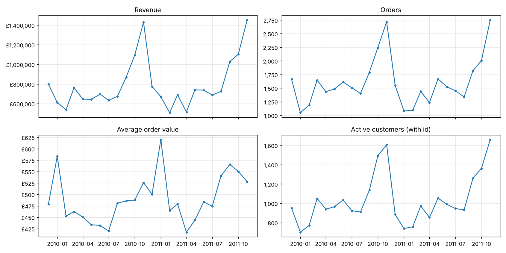
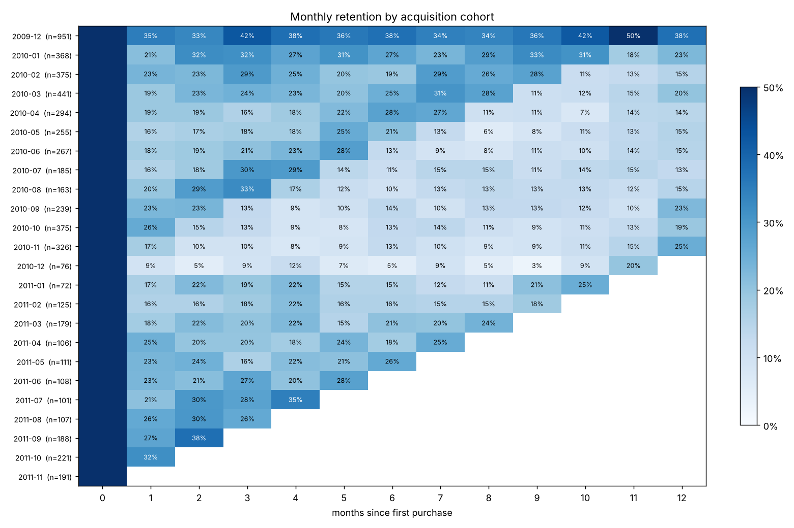
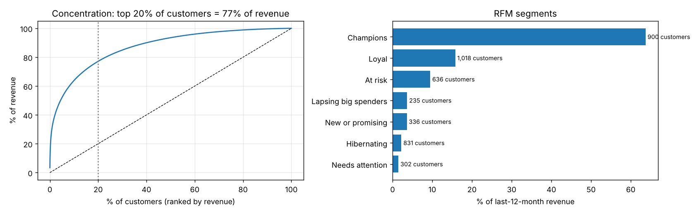

# Online Retail II: revenue, retention and baskets with SQL

[](https://colab.research.google.com/github/Ashhar-Hussain/retail-analytics-sql/blob/main/online_retail_sql_analytics.ipynb)
   

Two years of transactions (1,067,371 invoice lines, December 2009 to December 2011) from a UK online retailer of gifts and homeware, many of whose customers are wholesalers. Every number is produced by a SQL query in DuckDB; pandas is only used for charts and the Excel export.

## Highlights

| | |
|---|---|
| Data quality | 1,067,371 raw lines → **1,003,340** clean sales lines worth **£19.64 M** (cancellations, non-product codes, non-positive quantities/prices and 34,335 exact duplicates removed); 13.1% of revenue has no customer id |
| Growth | January–November 2011 revenue **+3.0%** on 2010, with a strong autumn peak |
| Retention | median month-1 retention across acquisition cohorts **20.8%**, month-3 20.1%; the first cohort retains far better, so blended numbers overstate how sticky new customers are |
| Concentration | top 20% of customers = **77%** of revenue; top 1% = 32% |
| Baskets | 1,378 product pairs with support, confidence and lift from a SQL self-join; the strongest pairs are design variants of the same item, a cue for bundles |
| Geography | UK = 86% of revenue; international markets order larger baskets |





## What is inside

* A data-quality audit written as one SQL query, so the cleaning rules are documented by the code.
* Monthly KPIs and year-on-year growth (CTEs, date truncation, self-joins on month).
* Acquisition cohorts and a retention matrix.
* Pareto curve and RFM scoring with `NTILE` window functions, mapped to segments with suggested actions.
* Market-basket analysis (support, confidence, lift) for UK orders in 2011.
* A 7-sheet Excel pack (`outputs/online_retail_analysis.xlsx`) for a commercial team.

## Run it

Colab badge above (CPU, about 5 minutes; the first run converts the Excel source to Parquet), or locally:

```bash
pip install -r requirements.txt
jupyter nbconvert --to notebook --execute online_retail_sql_analytics.ipynb
```

Data: Chen, D. (2012). *Online Retail II*. UCI Machine Learning Repository, [doi:10.24432/C5CG6D](https://doi.org/10.24432/C5CG6D) (CC BY 4.0), downloaded on first run.

## Citation

```bibtex
@software{hussain2026retailanalyticssql,
  author  = {Hussain, Ashhar},
  title   = {Online Retail II: revenue, retention and baskets with SQL},
  year    = {2026},
  url     = {https://github.com/Ashhar-Hussain/retail-analytics-sql},
  version = {1.0.0}
}
```

## License

Code: MIT. Data: CC BY 4.0.
